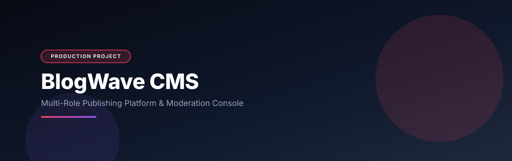
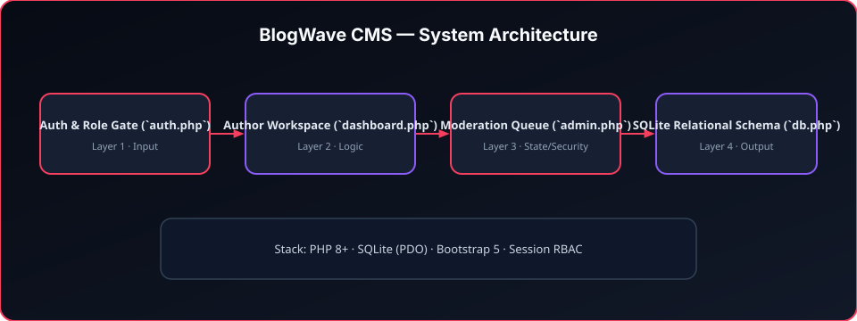
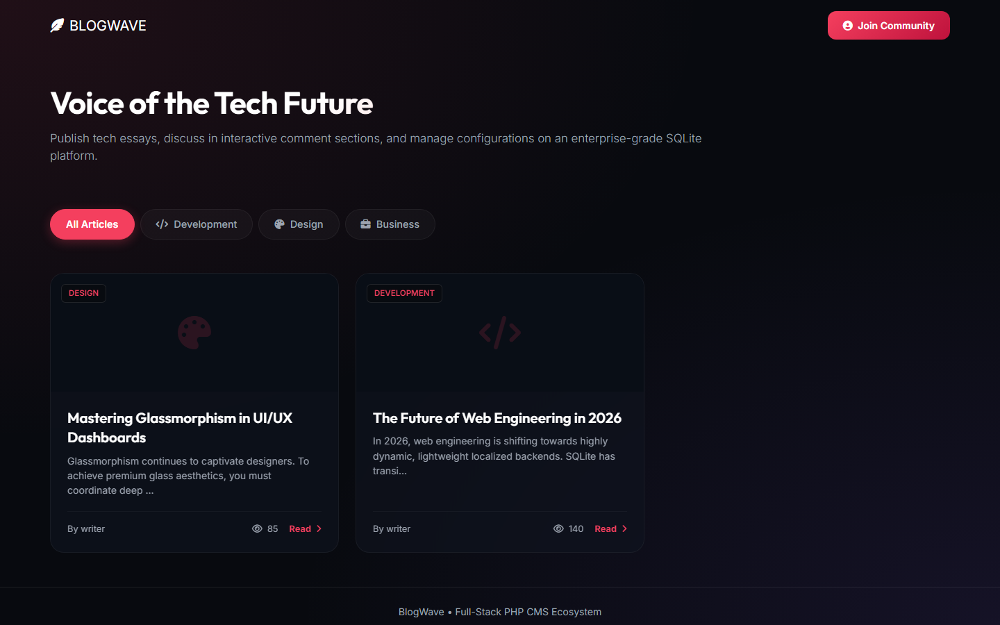

# BlogWave CMS

> Multi-Role Publishing Platform & Moderation Console

 -1e293b?style=flat-square)   



## 📌 Executive Overview
Full-stack PHP 8+ and zero-config SQLite community blogging platform supporting Reader, Author, and Superadmin roles, `password_hash` authentication, post draft approvals, and comments.

---

## 🏛️ System Architecture



---

## 📷 Live Application Interface

Below is a genuine live capture rendered from the running local application:



---

## 🛠️ Tech Stack
- **PHP 8+**
- **SQLite (PDO)**
- **Bootstrap 5**
- **Session RBAC**

---

## 🚀 How to Run

1. **Clone the repository:**
   ```bash
   git clone https://github.com/pushpikaodisha/blogwave.git
   cd blogwave
   ```

2. **Launch locally:**
   Start PHP built-in server: `php -S localhost:8000` and open `http://localhost:8000/`. Demo logins: `admin` / `admin123` or `writer` / `writer123`.

---

## 👨‍💻 Author & Lead Maintainer

<table>
  <tr>
    <td align="center" width="150" valign="middle">
      <a href="https://github.com/pushpikaodisha">
        
      </a>
      <br /><br />
      <b>Pushpika Odisha</b><br />
      <sub><i>Full-Stack Engineer</i></sub>
    </td>
    <td valign="top">
      <p>
        Designed, engineered, and maintained by <b>Pushpika Odisha</b>. Full-Stack Engineer focused on building scalable web architectures, robust backend systems, and responsive, high-performance digital experiences.
      </p>
      <p>
        <a href="https://github.com/pushpikaodisha"></a>
        <a href="mailto:pushpikaodisha.contact@gmail.com"></a>
        <a href="https://github.com/pushpikaodisha?tab=repositories"></a>
      </p>
    </td>
  </tr>
</table>

---

## 📄 License
Distributed under the **MIT License**.
